# Pre-DQ flow

How a payment event moves through `src/dq/pre_dq_checks.py`, from Kafka to Postgres.

```mermaid
flowchart TD
    %% ---------------- source ----------------
    P["Producer<br/>(src/producer)"] -->|"key = card_token<br/>value = JSON bytes"| K[("Kafka topic<br/>payments.raw")]

    %% ---------------- fetch ----------------
    subgraph FETCH["1 · Fetch  —  main() / build_spark() / read_raw_events()"]
        direction TB
        S["Spark Structured Streaming<br/>ANSI mode · UTC · Kafka connector"]
        R["readStream from TOPIC_RAW<br/>startingOffsets: latest (env)<br/>max 5000 msgs per micro-batch"]
        CP[("Checkpoint<br/>CHECKPOINT_DIR/pre_dq_to_postgres<br/>remembers processed offsets")]
        S --> R
        R <-.-> CP
    end
    K --> R

    %% ---------------- prepare ----------------
    subgraph PREP["2 · Prepare each message once  —  prepare()"]
        direction TB
        A1["bytes → text<br/>valid UTF-8? empty / whitespace?"]
        A2["try_parse_json → VARIANT<br/>(NULL if not JSON, never crashes)"]
        A3["is it a JSON object?"]
        A4["for each of 11 contract fields:<br/>present? · JSON type · string value ·<br/>typed value (decimal / timestamp / int) ·<br/>blank? · type ok?"]
        A1 --> A2 --> A3 --> A4
    end
    R -->|"micro-batch of raw rows<br/>(key, value, topic, partition, offset, timestamp)"| A1

    %% ---------------- rules ----------------
    subgraph RULES["3 · Run the rule registry  —  apply_pre_dq_checks()"]
        direction TB
        M["Fatal message rules (first hit only)<br/>empty_message → bad_encoding →<br/>malformed_json → not_json_object"]
        MF{"fatal rule<br/>fired?"}
        FR["Field rules, per field (first hit only)<br/>missing_field → null_or_blank_field →<br/>invalid_type → invalid_format"]
        AR["Always-run rules<br/>pan_detected · unsupported_schema_version"]
        COL["Collect every failure into dq_failures<br/>[(rule, field, reason), ...]"]
        M --> MF
        MF -->|"no"| FR --> AR
        MF -->|"yes: skip field rules"| AR
        AR --> COL
    end
    A4 --> M

    D{"dq_failures<br/>empty?"}
    COL --> D
    D -->|"yes"| ACC["dq_status = ACCEPTED<br/>typed fields · schema_version defaults to 1"]
    D -->|"no"| REJ["dq_status = REJECTED<br/>dq_rule / dq_reason = first failure"]

    %% ---------------- store ----------------
    subgraph STORE["4 · Store each micro-batch  —  process_batch() via foreachBatch"]
        direction TB
        AR2["accepted_rows()<br/>timestamps → UTC ISO strings"]
        RR2["rejected_rows()<br/>reason = all reasons joined '; '<br/>dq_failures → JSON<br/>_safe_text: mask card numbers,<br/>escape NUL, cap length"]
        TX["ONE Postgres transaction"]
        IV["INSERT payment_events_validated<br/>ON CONFLICT DO NOTHING<br/>(unique: event_id, source offset)"]
        II["INSERT payment_events_invalidated<br/>ON CONFLICT DO NOTHING<br/>(unique: source offset)"]
        OK{"insert<br/>succeeded?"}
        AR2 --> TX
        RR2 --> TX
        TX --> IV --> II --> OK
    end
    ACC --> AR2
    REJ --> RR2

    OK -->|"yes"| C["COMMIT"]
    OK -->|"no"| RB["ROLLBACK + raise<br/>stream stops"]
    RB -.->|"on restart: same offsets re-read<br/>from checkpoint; DO NOTHING makes replay safe"| CP

    C --> PGV[("Postgres<br/>payment_events_validated")]
    C --> PGI[("Postgres<br/>payment_events_invalidated")]
    C --> LOG["Logs<br/>one line per rejected event (offset, rule, reason; no payload)<br/>+ batch summary: received / accepted / rejected / stored / skipped"]

    PGV -.->|"next stages (not built yet):<br/>use-case DQ checks → fraud processor"| NEXT["Use-case DQ<br/>amount · currency · +24h"]
```

## Stage summary

| Stage | Function | What happens |
|---|---|---|
| 1. Fetch | `main`, `build_spark`, `read_raw_events` | Read `.env`; start Spark (ANSI, UTC, Kafka connector); stream `payments.raw` in micro-batches of up to 5000 messages. The checkpoint stores processed offsets so a restart resumes where it stopped. |
| 2. Prepare | `prepare` | Parse each message once: text, UTF-8, empty, JSON, object, then extract and type every contract field. Nothing can crash here; bad input becomes flags. |
| 3. Check | `apply_pre_dq_checks` + rule functions | Fatal message rules, then per-field rules (skipped if a fatal rule fired), then always-run rules. All failures are collected; no failures = ACCEPTED. |
| 4. Store | `process_batch`, `accepted_rows`, `rejected_rows`, `insert_rows` | ACCEPTED → `payment_events_validated`, REJECTED → `payment_events_invalidated` (with `reason`), in one transaction. Duplicates and replays are skipped by `ON CONFLICT DO NOTHING`. Rejections and a batch summary are logged. |

## Guarantees

- **No event is lost.** Every message ends up in exactly one of the two tables.
- **Replay-safe.** Re-reading the same offsets never creates duplicate rows.
- **All or nothing per batch.** Both tables are written in one transaction; on failure nothing is committed and the batch is re-run after restart.
- **No card numbers stored or logged.** Card-number-like digits are masked before storage; logs never include the payload.
